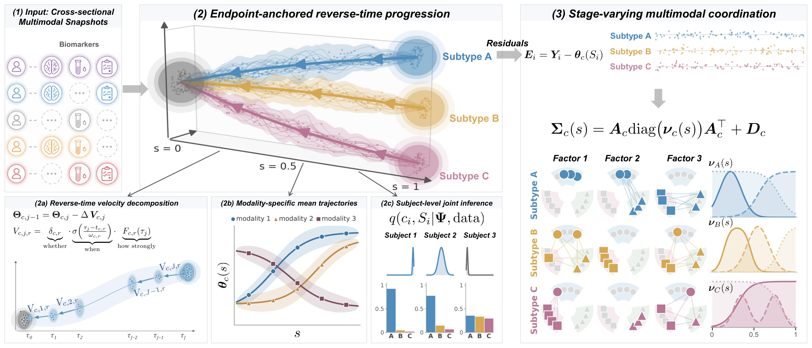

<div align="center">

# ELPAC

**Endpoint-anchored Latent Progression And Coordination**

*Reference implementation for* **[ELPAC: Endpoint-Anchored Latent Progression with Stage-Varying Multimodal Coordination](https://arxiv.org/abs/2611.08541)** (NeurIPS 2026)

Shengxian Ding, Yifei Zhang, Xinyuan Tian, Yuanshuang Guo, Yize Zhao

[](https://arxiv.org/abs/2611.08541)
[](https://www.python.org/)
[](https://github.com/google/jax)
[](https://github.com/pyro-ppl/numpyro)
[](LICENSE)

</div>

<p align="center">
  
</p>

<p align="center"><sub><b>ELPAC workflow.</b> (1) Anchor-supervised, partially observed cross-sectional multimodal snapshots.
(2) Subtype trajectories are integrated <i>backward</i> from clinically reliable endpoint groups toward a shared healthy origin
along biologically structured velocity components, yielding subtype mean trajectories and a joint posterior over subtype and stage.
(3) Residuals around the recovered stage axis factorize into sparse coordination axes,
Σ<sub>c</sub>(s) = A<sub>c</sub> diag(ν<sub>c</sub>(s)) A<sub>c</sub><sup>⊤</sup> + D<sub>c</sub>, whose loadings show <i>which</i>
multimodal programs operate in each subtype and whose activations show <i>when</i> they emerge.</sub></p>

---

## Overview

Aging cohorts combine imaging, plasma, and cognitive measurements, but most subjects contribute only a
single, partially observed cross-sectional snapshot. ELPAC is a Bayesian framework that infers, jointly
and with uncertainty:

| Latent quantity | What ELPAC learns |
| --- | --- |
| **Subtype** c<sub>i</sub> | Which progression subtype best describes each subject (including preserved aging) |
| **Stage** S<sub>i</sub> ∈ (0, 1) | Continuous position along that subtype's trajectory |
| **Coordination** Σ<sub>c</sub>(s) | How measurements across modalities co-vary, and how that changes with stage |

It is built from two interlocking constructions:

- **Endpoint-anchored reverse-time progression.** Trajectories are anchored at the cohort's best-supervised
  subjects (clinical endpoint groups) and integrated backward to a shared healthy reference. Per-modality
  velocity components encode monotone direction, *whether* / *when* / *how strongly* each biomarker moves,
  and optional sequential (cascade) ordering priors.
- **Stage-varying multimodal coordination.** Residual variation around the stage axis is factorized into
  sparse coordination axes with stage-dependent activations ν<sub>c</sub>(s). The inferred stage axis
  supplies the auxiliary variation that makes this decomposition conditionally identifiable.

Inference uses **amortized variational inference**: a low-rank multivariate Gaussian over global parameters
paired with a recognition network for per-subject stage and subtype, so new subjects are scored in a single
forward pass.

## Installation

Python 3.11. With conda:

```bash
conda env create -f environment.yaml
conda activate elpac-demo
```

Or with pip:

```bash
python -m venv .venv && source .venv/bin/activate
pip install -r requirements.txt
```

Pinned core dependencies: `jax==0.9.2`, `jaxlib==0.9.2`, `numpyro==0.20.1`, `flax==0.12.6`, `optax==0.2.8`
(plus `numpy`, `scipy`, `scikit-learn`, `pyyaml`).

> **Hardware.** `run_synthetic.py` sets `JAX_PLATFORMS=cpu` and runs on CPU. The production runs reported in
> the paper used a single NVIDIA RTX Pro 6000 Blackwell GPU.

## Quick start

Fit one seed of the headline synthetic experiment (~3–5 min on a 2-core CPU):

```bash
python run_synthetic.py --seeds 0
```

Several seeds:

```bash
python run_synthetic.py --seeds 0,1,2,3 --outdir artifacts/
```

### Command-line options

| Flag | Default | Description |
| --- | --- | --- |
| `--seeds` | *(required)* | Comma-separated fitting seeds, e.g. `0,1,2,3` |
| `--simulator-seed` | `42` | Seed for the synthetic-cohort generator (one shared cohort for all fitting seeds) |
| `--outdir` | `artifacts` | Output directory |
| `--include-cognition` / `--no-include-cognition` | on | Include or drop the cognition submodel |

## What the script does

`run_synthetic.py` first **simulates** one synthetic cohort from the generative model (`elpac.simulate`,
seeded by `--simulator-seed`). Then, for each fitting seed, it:

1. **Splits** the cohort into a stratified 80 / 20 train–test partition (`elpac.heldout.train_test_split`).
2. **Fits** ELPAC end-to-end on the train partition with phased SVI (`elpac.inference`).
3. **Scores recovery** on the train partition against simulator ground truth (`elpac.metrics`).
4. **Scores generalization** as held-out marginal log-likelihood per subject on the test partition.

### Synthetic setup (paper defaults)

| Setting | Value |
| --- | --- |
| Subjects N | 1,000 |
| Subtypes C | 3 |
| Latent coordination factors K | 3 |
| Trajectory shells J | 8 |
| Biomarkers R | 20 across 4 modalities (amyloid 5, tau 5, structural MRI / neurodegeneration 6, blood 4) |
| Supervision | 10 % endpoint anchors per subtype, 10 % healthy reference, 60 % unlabeled |
| Boundary-supervision priors | s<sub>A</sub> = 0.95, s<sub>H</sub> = 0.01, ε<sub>S</sub> = 0.1 (`ModelConfig.eps_pinning`) |

### Inference schedule

| Component | Setting |
| --- | --- |
| Global variational family | Low-rank multivariate Gaussian, rank r<sub>g</sub> = 10 |
| Recognition network | MLP, 2 hidden layers × 128, LayerNorm, SiLU, dropout 0.1 |
| Region gates | Concrete-relaxed Bernoulli, temperature annealed across phases |
| Phase 1 | Mean trajectories only, Adam lr 3e-3 |
| Phase 2 | + Stage-varying covariance, Adam lr 1e-3 |
| Optimization | Minibatch 256, gradient clip 5 |

Step counts in `run_synthetic.py` (8,000 phase-1 and 10,000 phase-2 steps, followed by a 10,000-step
phase-2 refit) are shorter than the 5 × 10<sup>4</sup> steps per phase listed in App. B.2 of the paper.

### Output

Results are written to `<outdir>/seeds_<first>_<last>.json`, a list with one record per seed:

```json
{
  "seed": 0,
  "gates": ...,
  "loss": ...,
  "wall_s": ...,
  "metrics": { "subtype_accuracy_general": ..., "subtype_ari": ..., "stage_spearman_rho": ...,
               "mean_trajectory_rmse": ..., "loading_procrustes_mean": ..., "heldout_ll": ..., ... }
}
```

`metrics` includes subtype accuracy and ARI, stage Spearman ρ and MAE, mean-trajectory RMSE, loading
Procrustes distance, activation recovery, ECE, Brier score, and held-out log-likelihood. `gates` counts how
many of the following recovery checks the fit passes:

| Metric | Pass if |
| --- | --- |
| `stage_spearman_rho` | > 0.90 |
| `subtype_ari` | > 0.85 |
| `subtype_accuracy_general` | > 0.85 |
| `mean_trajectory_sup_norm` | < 0.15 |
| `mean_trajectory_rmse` | < 0.15 |
| `loading_procrustes_mean` | < 0.15 |
| `activation_sup_norm_relative_mean` | < 0.20 |

The synthetic-recovery numbers in the paper are means ± SE over 100 independent replicate cohorts. To fit
100 replicates, each on its own simulated cohort, and summarize them:

```bash
for s in $(seq 0 99); do python run_synthetic.py --seeds $s --simulator-seed $s --outdir artifacts/; done
python - <<'EOF'
import json, glob, numpy as np
recs = [r for f in glob.glob("artifacts/seeds_*.json") for r in json.load(open(f))]
for k in sorted(recs[0]["metrics"]):
    v = np.array([r["metrics"][k] for r in recs if isinstance(r["metrics"].get(k), (int, float))], float)
    if v.size:
        print(f"{k:40s} {v.mean():.4f} ± {v.std(ddof=1) / np.sqrt(v.size) if v.size > 1 else 0:.4f}  (n={v.size})")
EOF
```

## Derived quantities

`elpac.analysis` computes interpretable summaries in closed form from a fitted (A<sub>c</sub>, ν<sub>c</sub>(s), D<sub>c</sub>):

| Module | Quantity |
| --- | --- |
| `correlations` | Stage-dependent correlation ρ<sub>c</sub>(r, r′; s) (paper Eq. 30) and liquid association ∂ρ/∂s (`liquid_association_closed_form`) |
| `fisher_weights` | Per-modality Fisher-information weights w<sup>FI</sup><sub>c,m</sub>(s) (paper Eqs. 31–32): which modality is most informative about stage at each s |
| `o_information` | Total correlation, dual total correlation, O-information Ω(s), synergy/redundancy crossings, delta-method CIs |

Liquid association and the `o_information` module are additional summaries that the paper does not report.

## Paper-to-code map

Section numbers refer to [arXiv:2611.08541](https://arxiv.org/abs/2611.08541).

| Paper | Code |
| --- | --- |
| §2.2 Observation model; §2.3 Construction I (endpoint-anchored progression); §2.4 Construction II (stage-varying coordination); App. B.1 joint likelihood | `elpac/model.py`, `elpac/utils/bspline.py` |
| §2.4–2.5 Identifiability constraints (lower-triangular A<sub>c</sub> with positive diagonal; centered w<sub>c,k</sub>, 1<sup>⊤</sup>w<sub>c,k</sub> = 0) | `elpac/utils/constraints.py` |
| §2.6 and App. B.2 Inference (low-rank global guide, recognition network, two-phase schedule) | `elpac/inference.py`, `elpac/amortized_guide.py` |
| App. B.3 Sylvester–Woodbury determinant and inverse (Eq. 29) | `elpac/utils/covariance.py` |
| App. B.3 Derived summaries (Eqs. 30–32) | `elpac/analysis/correlations.py`, `elpac/analysis/fisher_weights.py` |
| §3.1 Synthetic cohorts (setup, 80/20 split, held-out NLL) | `elpac/simulate.py`, `elpac/heldout.py`, `run_synthetic.py` |
| App. D.4 Metric definitions | `elpac/metrics.py` |

## Repository layout

```
.
├── elpac/                    # Importable package
│   ├── model.py              # NumPyro generative model (ModelConfig)
│   ├── simulate.py           # Synthetic-cohort generator
│   ├── inference.py          # Phased SVI driver (TrainConfig, run_full_pipeline)
│   ├── amortized_guide.py    # Amortized recognition network
│   ├── heldout.py            # Stratified train/test split + held-out marginal LL
│   ├── metrics.py            # Recovery metrics and calibration (ECE, Brier)
│   ├── utils/                # B-splines, constraints, Sylvester–Woodbury covariance, spatial kernels
│   └── analysis/             # Correlations / liquid association, O-information, Fisher weights
├── assets/                   # README figures
├── run_synthetic.py          # Entry point: simulate → fit → evaluate
├── environment.yaml          # conda env (elpac-demo)
├── requirements.txt          # pip alternative
└── LICENSE                   # MIT
```

## Scope

This repository contains the headline synthetic experiment. Not included: the other synthetic studies
(covariance ablation, sample-size sweep, robustness, sensitivity, guide ablation), the masked
leave-one-modality-out NLL evaluation, the external baselines (SuStaIn, MoPoE-VAE, HEALNet, etc.), and the
ADNI + NACC/SCAN real-data pipeline, which depends on access-controlled data.

## Citation

```bibtex
@inproceedings{ding2026elpac,
  title     = {{ELPAC}: Endpoint-Anchored Latent Progression with Stage-Varying Multimodal Coordination},
  author    = {Ding, Shengxian and Zhang, Yifei and Tian, Xinyuan and Guo, Yuanshuang and Zhao, Yize},
  booktitle = {Advances in Neural Information Processing Systems},
  year      = {2026}
}

@article{ding2026elpac_arxiv,
  title         = {{ELPAC}: Endpoint-Anchored Latent Progression with Stage-Varying Multimodal Coordination},
  author        = {Ding, Shengxian and Zhang, Yifei and Tian, Xinyuan and Guo, Yuanshuang and Zhao, Yize},
  journal       = {arXiv preprint arXiv:2611.08541},
  year          = {2026},
  eprint        = {2611.08541},
  archivePrefix = {arXiv},
  primaryClass  = {stat.ML},
  doi           = {10.48550/arXiv.2611.08541}
}
```

## License

MIT — see [`LICENSE`](LICENSE).
